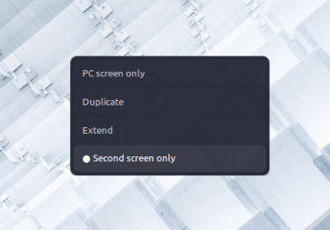

<div align="center">

# ⚡ project-menu

**The Win + P display switcher for Linux — quiet, fast, and out of the way.**

Four display modes, one keystroke, every desktop. Federated backend auto-detection means it just works — on GNOME, KDE, Cinnamon, Sway, Hyprland, COSMIC, XFCE, and everyone else.

[badges-start]
[](https://www.python.org/)
[](LICENSE)
[]()
[](tests/)
[](CONTRIBUTING.md)
[badges-end]

<p align="center">
  <a href="#-visual-tour">Visual Tour</a> •
  <a href="#-features">Features</a> •
  <a href="#-quick-start">Quick Start</a> •
  <a href="#%EF%B8%8F-keyboard-shortcuts">Shortcuts</a> •
  <a href="#-support-matrix">Support Matrix</a> •
  <a href="#-cli-power-tools">CLI</a> •
  <a href="#%EF%B8%8F-troubleshooting">Troubleshooting</a> •
  <a href="#-extensibility">Extend It</a>
</p>

</div>

## What it does

Press **<kbd>Super</kbd> + <kbd>P</kbd>** anywhere and a small, borderless card appears sharing your display setup:

```text
  ╭──────────────────────────╮
  │   PC screen only         │
  │   Duplicate              │
  │ ● Extend                 │      ← the dot marks your current mode
  │   Second screen only     │
  ╰──────────────────────────╯
```

**Zero configuration required.** At launch, `project-menu` inspects the session and routes each mode to the right engine underneath — **Mutter's D-Bus API**, **KScreen**, **swaymsg**, **hyprctl**, **wlr-randr**, or **xrandr** — so the same UX works everywhere.

## 🎨 Visual Tour

The real thing, in production on Cinnamon/X11:

<p align="center">
  
</p>

A flat, theme-aware card: four plain text rows, no icons, no chrome. The dot marks the active mode; the focused row gets a faint highlight. It centers on your active monitor, overlays via `gtk-layer-shell` where available, and vanishes as soon as you click or move focus away.

Choosing a mode is not a leap of faith — applying always shows a 15-second safety sheet that **auto-reverts** if something goes wrong (or if your eyes don't come back):

```text
  ╭───────────────────────────────────────────╮
  │   Keep this display configuration?        │
  │   Reverting in 13s                        │
  │                                           │
  │         [ Revert ]         [ Keep ]       │
  ╰───────────────────────────────────────────╯
```

---

## ✨ Features

| | |
|---|---|
| 🍃 **Minimal** | A flat, borderless card that tracks the native dark/light theme — no icons, gradients, or chrome. |
| 🌙 **Silent launch** | A plain `project-menu` launch forks itself into the background — no terminal windows. `--foreground`/`--debug` bring it back to the console. |
| ⚡ **Runtime detection** | Picks the best backend from `$XDG_SESSION_TYPE`, `$XDG_CURRENT_DESKTOP`, `$WAYLAND_DISPLAY`, `$HYPRLAND_INSTANCE_SIGNATURE`, `$SWAYSOCK` — or override with `--backend`. |
| 🛡️ **15-second revert** | Automatic rollback timer on every change prevents black-screen lockouts. |
| 🔁 **Win+P cycling** | Single-instance via `Gio.Application`: press <kbd>Super</kbd>+<kbd>P</kbd> repeatedly to cycle modes. |
| 🖥️ **Smart routing** | 1 monitor → gentle note. 2 monitors → instant zero-click switching. 3+ → interactive target picker. |
| 🧭 **Extend positioning** | Place the second screen `right`, `left`, `above`, or `below` — remembered defaults per session. |
| 🪞 **Intelligent mirroring** | Negotiates the highest shared resolution and warns when refresh rates diverge. |
| ⌨️ **Keyboard-first** | Arrows/Tab navigation, `1`–`4` direct triggers, <kbd>Enter</kbd> to apply, <kbd>Esc</kbd> to dismiss. |
| 🧰 **Scriptable CLI** | Dry-run planning, direct mode application, output targeting — for scripts, stream decks, dotfiles. |
| 📦 **Universal installer** | Auto-resolves dependencies for `apt`, `dnf`, `pacman`, and `zypper` — only what your desktop needs. |

---

## 🚀 Quick Start

### 1. One-line installer (recommended)

```bash
git clone https://github.com/keshavsapra/project-menu.git
cd project-menu
./install.sh
```

The installer detects your package manager, installs **only** the libraries your current desktop uses, copies a `project-menu` wrapper to `~/.local/bin`, and registers the <kbd>Super</kbd>+<kbd>P</kbd> hotkey.

> [!TIP]
> On tiling compositors (Sway, Hyprland, i3), `install.sh` never touches your dotfiles without permission — it prints the exact config snippet, or writes it for you with `--append-config`.

### 2. pipx

```bash
pipx install .
project-menu --list
```

> [!NOTE]
> pipx installs the Python entry point only. Run `./install.sh` (or your package manager) for system packages like `python3-gi` and `gir1.2-gtk-3.0`, and for desktop hotkey registration.

### 3. Uninstalling

```bash
./uninstall.sh
```

> [!IMPORTANT]
> **Launching in the background.** A plain `project-menu` (or `python3 main.py`) launch detaches itself — no terminal window appears or stays open. Use `project-menu --foreground` (or `--debug`) to watch it in the console.

---

## ⌨️ Keyboard Shortcuts

| Shortcut | Action | Description |
|---|---|---|
| <kbd>Super</kbd> + <kbd>P</kbd> | **Launch / Cycle** | Opens the menu; pressing again while open cycles selection |
| <kbd>↑</kbd> / <kbd>↓</kbd> | **Navigate** | Move focus between display modes |
| <kbd>Tab</kbd> / <kbd>Shift</kbd>+<kbd>Tab</kbd> | **Navigate** | Move focus forwards or backwards |
| <kbd>1</kbd> · <kbd>2</kbd> · <kbd>3</kbd> · <kbd>4</kbd> | **Quick Select** | 1=PC only · 2=Duplicate · 3=Extend · 4=Second only |
| <kbd>Enter</kbd> | **Apply** | Apply the selected display configuration |
| <kbd>Esc</kbd> | **Dismiss** | Close popup without changes |
| *Click outside / blur* | **Dismiss** | Closes popup on focus loss |

---

## 📊 Support Matrix

First-class support everywhere:

| Desktop / WM | Session | Display Backend | Overlay | Hotkey Mechanism | Status |
|---|---|---|---|---|:---:|
| **GNOME / Ubuntu** | Wayland | Mutter D-Bus (`org.gnome.Mutter.DisplayConfig`) | Centered window¹ | `gsettings` custom keybinding | ✅ |
| **GNOME / Ubuntu** | X11 | `xrandr` | Always-on-top overlay | `gsettings` custom keybinding | ✅ |
| **KDE Plasma** | Wayland | `kscreen-doctor` | `gtk-layer-shell` overlay | `kglobalaccel` shortcut | ✅ |
| **KDE Plasma** | X11 | `xrandr` | Always-on-top overlay | `kglobalaccel` shortcut | ✅ |
| **Sway** | Wayland | `swaymsg` | `gtk-layer-shell` overlay | Config snippet² | ✅ |
| **Hyprland** | Wayland | `hyprctl` | `gtk-layer-shell` overlay | Config snippet² | ✅ |
| **wlroots** (river, labwc, Wayfire) | Wayland | `wlr-randr` | `gtk-layer-shell` overlay | Config snippet² | ✅ |
| **COSMIC** | Wayland | `cosmic-randr` | `gtk-layer-shell` overlay | Desktop shortcut / CLI | ✅ |
| **XFCE** | X11 | `xrandr` | Always-on-top overlay | `xfconf-query` | ✅ |
| **Cinnamon / MATE** | X11 | `xrandr` | Always-on-top overlay | `gsettings` (`custom-list`) / media-keys | ✅ |
| **i3 / bspwm / Openbox** | X11 | `xrandr` | Always-on-top overlay | Xlib `XGrabKey` daemon | ✅ |

<small>
¹ GNOME Wayland deliberately doesn't implement <code>wlr-layer-shell</code>; the popup opens as a standard floating window.<br>
² Snippets preserve your dotfiles; pass <code>--append-config</code> to have the installer write them.
</small>

---

## 🧰 CLI Power Tools

```bash
# The interactive popup (backgrounds itself)
project-menu

# Every screen, its state, resolution and refresh rate
project-menu --list

# Goodbye popup — switch instantly
project-menu --mode extend
project-menu --mode duplicate
project-menu --mode internal
project-menu --mode external

# Where does the second screen go? (right | left | above | below)
project-menu --mode extend --position above

# Target a specific screen on 3+ monitor rigs
project-menu --mode extend --output DP-2

# See exactly what would run, without running it
project-menu --dry-run --mode extend

# Apply with the 15-second safety net + confirmation
project-menu --mode duplicate --confirm

# Debug environment detection / force a backend
project-menu --debug
project-menu --backend hyprland
```

---

## 🩺 Troubleshooting

### Super+P does nothing
1. Confirm the registration: `project-menu --register-hotkey` prints every gsettings/dconf write it performs — it should succeed without errors.
2. On **Cinnamon**, check `gsettings get org.cinnamon.desktop.keybindings custom-list` — it must reference `custom0` (open *System Settings → Keyboard → Shortcuts → Custom* to confirm the entry exists).
3. On **GNOME**, another extension may claim <kbd>Super</kbd>+<kbd>P</kbd>. Disable it, or re-register with a different combo.
4. Last resort: open the Keyboard settings, flip our binding off and back on, and re-apply.

### Error toasts when applying (`notify-send`)
Failing applies raise a desktop notification with the backend error. Run `project-menu --dry-run --mode <mode>` to see the exact commands, then run them manually to see the raw compositor error.

### Wrong display picked in multi-screen rigs
State the output explicitly:

```bash
project-menu --mode extend --output DP-2
```

### Popup opens off-screen or unfocused
The popup centers on your **primary monitor** by design, and always registers on the session bus (single instance). Run `project-menu --debug --foreground` and paste the log (`~/.local/state/project-menu/log`) into an issue.

### Logs
Everything important is logged to `~/.local/state/project-menu/log`:

```bash
tail -f ~/.local/state/project-menu/log
```

---

## 🧪 Testing & Diagnostics

**107 tests**, all mocked (xrandr text, D-Bus payloads, swaymsg/hyprctl JSON…) — the whole suite runs headless on any machine, including CI:

```bash
python3 -m unittest discover -s tests        # full suite
python3 -m unittest tests.test_x11_backend   # one module
```

No second monitor? Simulate multi-head in seconds:

<details>
<summary><b>Virtual display recipes</b></summary>

#### X11 — virtual monitor

```bash
xrandr --setmonitor VIRTUAL1 1920/520x1080/290+1920+0 none
project-menu --list
xrandr --delmonitor VIRTUAL1   # cleanup
```

#### X11 — headless Xvfb

```bash
Xvfb :99 -screen 0 1920x1080x24 &
DISPLAY=:99 project-menu --list
```

#### Sway — headless output

```bash
swaymsg create_output
swaymsg output HEADLESS-1 resolution 1920x1080
project-menu --list
```

#### Hyprland — headless output

```bash
hyprctl output create headless
project-menu --list
```

</details>

---

## 📐 Adding a New Backend

Support for any compositor is ~50 lines of Python.

**1. Create `backends/mywm.py`**

```python
from backends.base import SubprocessBackend
from interfaces import ApplyResult, DisplayMode, Output, Selection
from core import infer_mode, primary_output

class MyWMBackend(SubprocessBackend):
    name = "mywm"
    environments = ("wayland:mywm",)
    priority = 45  # lower = evaluated earlier

    @classmethod
    def can_handle(cls, env):
        return env.session_type == "wayland" and env.has_desktop("mywm")

    def list_outputs(self):
        res = self._run(["mywmctl", "list-displays"])
        return self.parse_outputs(res.stdout)   # hook your own JSON/text parser

    def get_current_mode(self):
        return infer_mode(self.list_outputs())

    def snapshot(self):   # plain list of Outputs — used by the revert timer
        return self.list_outputs()

    def restore(self, snapshot):
        ...

    def _build_commands(self, outputs, selection):
        if selection.mode == DisplayMode.INTERNAL:
            return ["mywmctl", "internal"]
        if selection.mode == DisplayMode.EXTEND:
            return ["mywmctl", "extend"]
        ...
```

**2. Register it** in `backends/registry.py`:

```python
from backends.mywm import MyWMBackend
BACKENDS.append(MyWMBackend)
ALIASES["mywm"] = "mywm"
```

**3. Test it** in `tests/test_mywm_backend.py` — `make_runner(...)` from `tests/helpers.py` injects canned stdout without spawning processes.

**4. Ship it** — logo optional, bragging rights guaranteed. Open a PR.

---

## 📁 Project Architecture

```
project-menu/
├── main.py                  # Entry point
├── cli.py                   # Argparse + dispatch (popup & CLI actions)
├── interfaces.py            # Typed dataclasses + the three ABCs
├── core.py                  # Geometry math, mode inference, logging, notify
├── detect.py                # Environment fingerprinting
├── backends/
│   ├── base.py              # SubprocessBackend with the _run() test seam
│   ├── gnome.py             # Mutter DisplayConfig D-Bus driver
│   ├── kde.py               # kscreen-doctor driver
│   ├── sway.py              # swaymsg IPC driver
│   ├── hyprland.py          # hyprctl driver
│   ├── wlroots.py           # wlr-randr driver
│   ├── cosmic.py            # cosmic-randr driver
│   ├── x11.py               # xrandr driver
│   └── registry.py          # Detection priority pipeline
├── hotkeys/
│   ├── gnome.py             # GNOME gsettings + Cinnamon custom-list + MATE
│   ├── kde.py               # kglobalaccel
│   ├── xfce.py              # xfconf-query
│   ├── wm.py                # Sway / Hyprland / i3 config snippets
│   └── x11_grab.py          # python-xlib XGrabKey daemon
├── ui/
│   ├── gtk_ui.py            # Minimal GTK 3/4 card (layer-shell aware)
│   ├── qt_ui.py             # Minimal Qt fallback
│   └── base.py              # Toolkit detection (GTK → Qt → None)
├── tests/                   # 107 fully-mocked unit tests
├── install.sh / uninstall.sh
└── pyproject.toml
```

---

## 🤝 Contributing

1. Fork it
2. Branch: `git checkout -b feature/amazing`
3. Keep the suite green: `python3 -m unittest discover -s tests`
4. Commit: `git commit -m 'feat: add amazing'`
5. Push, then open a Pull Request

New backends and hotkey registrars are the most welcome contributions — see [Adding a New Backend](#-adding-a-new-backend) above.

## 📜 License

MIT — see [`LICENSE`](LICENSE).

---

<div align="center">
  <sub>One keystroke, every desktop. Built with ❤️ for Linux frustration-free display switching.</sub>
</div>
